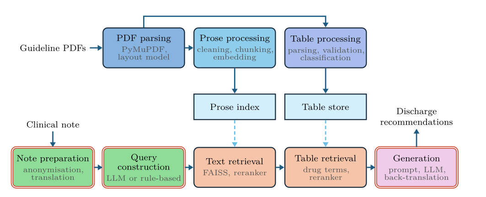

# ER Discharge Recommendations via RAG

A Retrieval-Augmented Generation pipeline that ingests ER clinical documents or their drafts, in Italian, and generates guideline-grounded discharge recommendations based on official European guidelines.

The system is divided into an offline and an online pipeline.
The former handles text parsing, cleaning and embedding of a PDF Guideline corpus.
The latter decomposes the input ER note into relevant queries, retrieves matching guideline passages through a multi-stage retrieval pipeline, and produces structured discharge recommendations via an LLM. Translation between Italian and English is done by the LLM by default, or by DeepL.

A procedure to build an exhaustive and authoritative Corpus is also implemented, though users can elect to utilise their own (as long as it consists of PDFs written in English).

The domain vocabulary (Clinical Note, Chunk, Excerpt, Grid Table, ...) is defined in `CONTEXT.md`.

For a detailed discussion of the architecture, evaluation, and design rationale, the project thesis is included in `docs/`.



## Repository Structure

```
.
├── code/
│   ├── main.py               # Main pipeline entry point
│   ├── app.py                # Streamlit UI: discharge recommendations (or only their prompt) from the PDF of an Italian ER report
│   ├── build_index.py        # Guideline ingestion and FAISS index builder
│   ├── config.py             # All configurable parameters (models, paths, API keys)
│   ├── ingestion/            # PDF parsing, cleaning, chunking and tables
│   ├── storage/              # Embeddings, FAISS index, TF-IDF vectorizer, table store
│   ├── retrieval/            # Query building, retrieval and re-ranking
│   ├── generation/           # Prompt building and LLM backends
│   ├── pipeline/             # Clinical note input, ER report parsing, translation
│   └── scraping/             # Builds the guideline corpus from PubMed, one module per step
├── docs/                      # Project paper (Thesis.pdf) and pipeline figure
├── Examples/                  # Sample clinical notes, translations, and generated outputs
├── Weights/                   # FAISS index, table store, TF-IDF vectorizer (not in git: run build_index.py on your guidelines)
├── Guidelines/                # Contains only a subfolder Sources, used for the scraping. If copying the guidelines in manually, the subfolder can be ignored or removed.
├── launch.sh                  # Starts the site (or opens it, if running) in the browser, for a shortcut
├── CONTEXT.md                 # Glossary of the domain terms used in code and docs
├── requirements.txt
└── README.md
```

## Setup

### 1. Install dependencies

```bash
pip install -r requirements.txt
```

#### llama-cpp-python (optional — only for quantized local models)

If you want to run quantized models locally via llama.cpp, the library requires a separate installation. The recommended approach is to use a **pre-built wheel** matching your CUDA version (supported for CUDA 12.1–12.5):

```bash
pip install llama-cpp-python \
  --extra-index-url https://abetlen.github.io/llama-cpp-python/whl/<cuda-version>
```

Replace `<cuda-version>` with your version, e.g. `cu124` for CUDA 12.4.

Alternatively, you can build from source, but it will take some time:

```bash
CMAKE_ARGS="-DGGML_CUDA=on" pip install llama-cpp-python
```

Full installation details: [llama-cpp-python GitHub](https://github.com/abetlen/llama-cpp-python)

### 2. Configure

All tunable parameters live in **`code/config.py`**, which is thoroughly commented. Key things to set up:

- **OpenRouter API key**: Required with `API = True` (the default): generation, LLM translation and LLM queries go through OpenRouter.
- **DeepL API key** and glossary id: Only needed when DeepL translates the note (see "Translation" below).
- **`RETRIEVAL_ONLY`**: `True` stops at the prompt and writes it as the output, without calling the LLM. Set it to `False` to generate the recommendations.
- Model paths, retrieval parameters, and generation settings can all be adjusted from this file.

### 3. Prepare the guidelines (only needed to rebuild the index)

If you already have a built `Weights/` folder (FAISS index, table store, vectorizer), you can skip this step. 

If you want to rebuild the index with new or updated guidelines:

1. Create a `Guidelines/` folder in the project root.
2. Place your guideline PDFs inside it, or let the scraper build the corpus from PubMed
   (`python code/scrape_guidelines.py --help` for its steps and options). Note that this operation requires several LLM calls and therefore comes at a cost if performed using APIs.
3. Run:

```bash
python code/build_index.py
```

> Guidelines and Weights are not included in the repository due to licensing issues.

## Usage

### Web app (Streamlit)

```bash
streamlit run code/app.py
```

Takes the PDF of a Verbale di Pronto Soccorso (anonymised before anything is translated) or a pasted note, and returns the
recommendations in Italian, each cited guideline linked to its PDF in `Guidelines/` at the page. "Solo prompt" returns only
the prompt, ready for copy-paste into an external LLM. `./launch.sh` starts the app on port 8501 (or opens it, if already running), for a desktop shortcut.

### Run on all clinical notes in the input folder (Examples/ITA)

```bash
python code/main.py
```

> The notes in the provided Examples folder serve only as reference and are not realistic. Notes used for during development and testing are not shared due to data protection agreements.

### Run on a single clinical note

```bash
python code/main.py <folder/filename>
```

> Accepts both txt and PDF files, though the former do not undergo the anonymisation process.

### Translation

Set in `code/config.py`:

- `USE_EXISTING_TRANSLATION = True` reuses the English note cached in `ENG/` (pre-translated notes ship in `Examples/ENG/`), so no translation service is needed.
- Otherwise the note is translated by the LLM (`LLM_TRANSLATION`, on whenever the LLM is used) or by DeepL.
- `OUTPUT_LLM_TRANSLATION` adds an Italian copy of the recommendations, written by the LLM in the same call (`OUTPUT_TRANSLATION_IN_PROMPT = True`) or in a second one.

## Results

The `Examples/` folder contains sample results including machine-generated Italian clinical notes, their English translations, and the generated discharge recommendations. Useful for understanding what the pipeline produces without running it yourself.


## Requirements

The system requires CUDA to run. Even with API-accessed LLMs, the rest of the pipeline requires around 4Gb of VRAM to function.